# Booking App

A React Native mobile application built with **Expo SDK 58**, **Expo Router**, and **TypeScript** for managing and checking into bookings across international timezones.

---

## Visual Overview & Product Screens

For complete functional and interaction documentation, see [App-flow.md](App-flow.md).

### 1. Polished Product Experience (Phase 7B)

| Booking List (7 Appointments & Checked-in Badge) | Search Filtered (`consult`) | Booking Details (Hero & Host Info) |
|:---:|:---:|:---:|
| 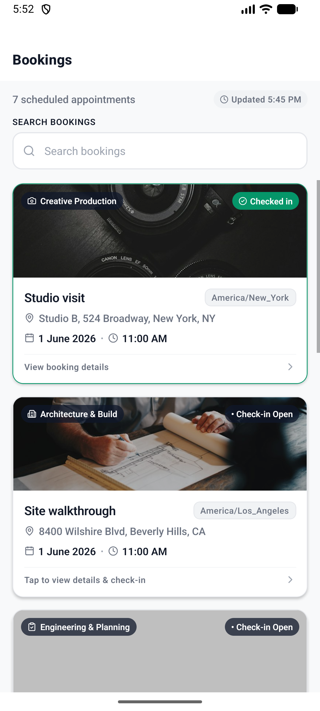 | 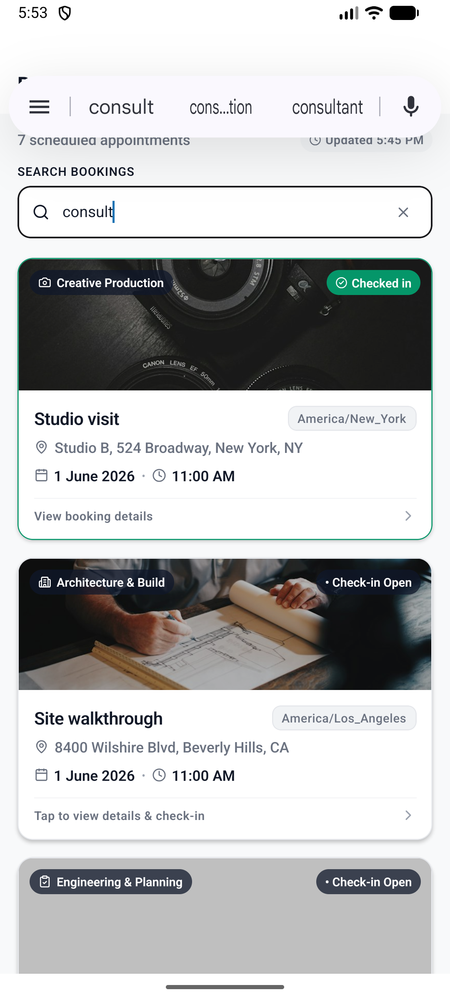 | 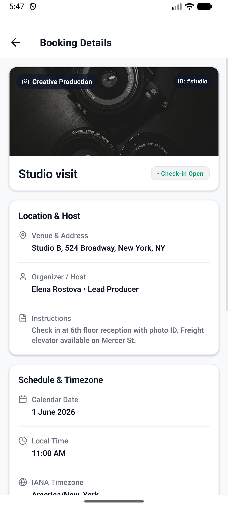 |
| *High-res banners, Lucide icons, & live Checked-in badge.* | *Instant debounce filtering for Chicago consultation.* | *Hero banner, venue address, host name, & schedule table.* |

| Check-in Confirmed (Persisted) | Empty Note Validation | Note Saved Feedback (`Note saved successfully`) |
|:---:|:---:|:---:|
| 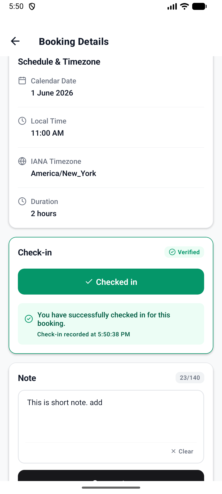 | 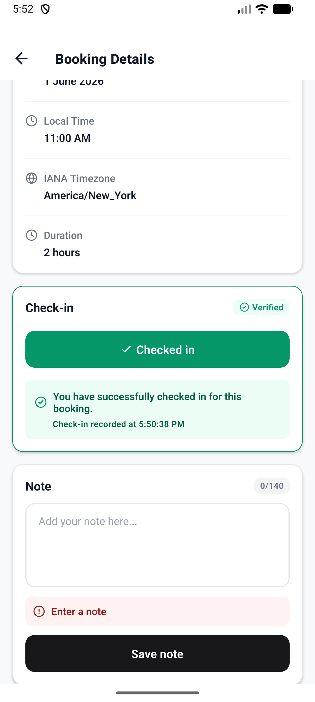 | 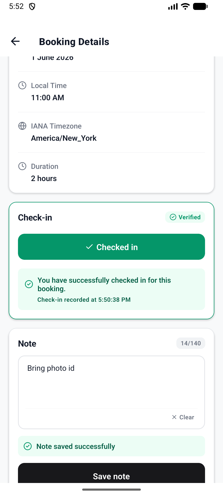 |
| *Verified emerald confirmation card with timestamp.* | *Rose alert banner preventing empty notes.* | *Clear "Note saved successfully" with Lucide CheckCircle2.* |

| Booking List (Dark Mode) | Booking Details (Dark Mode) | Keyboard Controller Active |
|:---:|:---:|:---:|
| 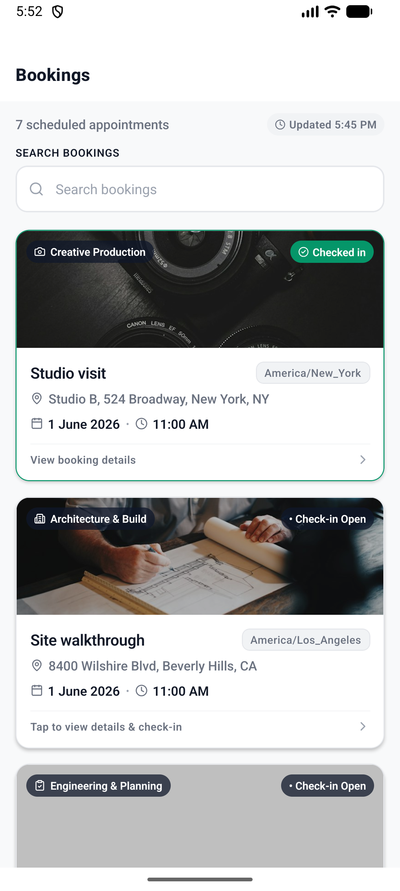 | 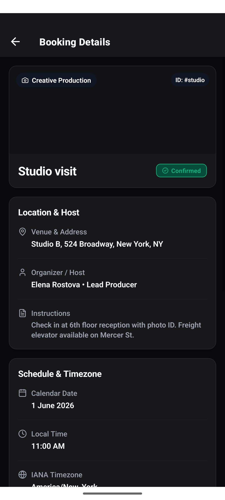 | 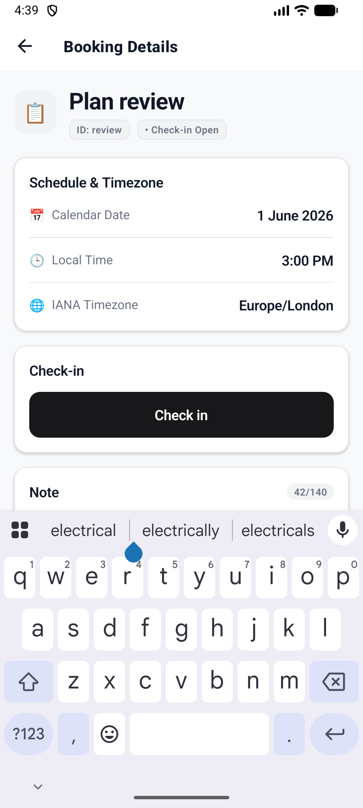 |
| *Deep slate `#0F172A` theme contrast.* | *Polished dark mode detail view.* | *KeyboardAvoidingView from react-native-keyboard-controller.* |

### 2. Baseline Screenshots & Edge Cases (Phase 7A)

| Empty Dataset (`EXPO_PUBLIC_BOOKINGS=empty`) | API Error & Retry (`EXPO_PUBLIC_BOOKINGS=error`) | No Match Search State |
|:---:|:---:|:---:|
| 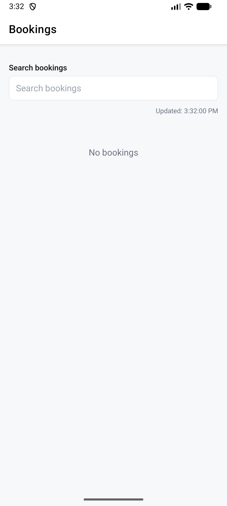 | 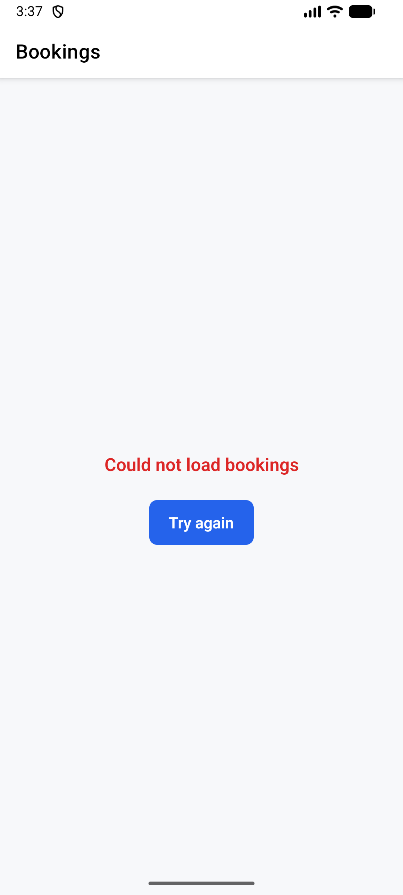 | 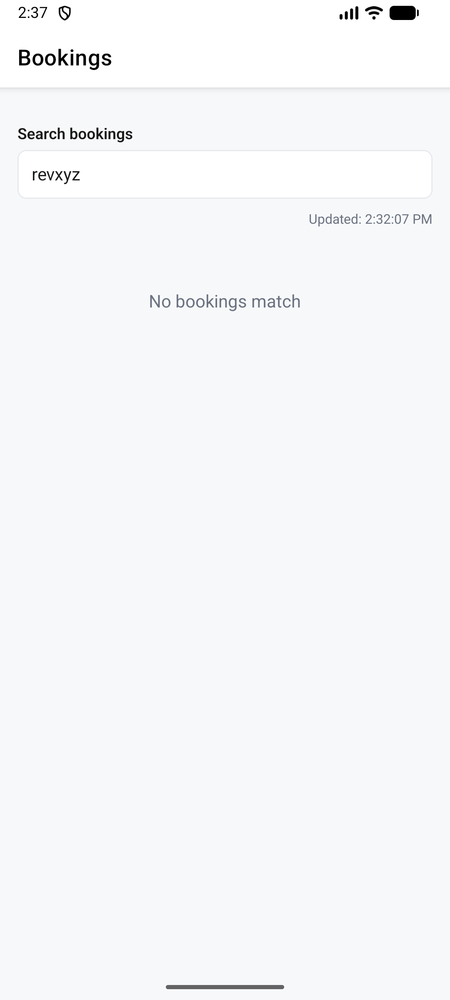 |
| *Server returning `[]` displays centered `No bookings`.* | *Server returning HTTP 500 displays `Could not load bookings` with retry button.* | *Search query with no matches showing empty state feedback.* |

---

## Features

- **Booking List (`/`)**:
  - Fetches bookings from remote API or in-app fake server.
  - Pull-to-refresh with a dynamic `Updated` timestamp label.
  - Curated high-resolution Unsplash architectural banner images per booking with category chips.
  - Crisp vector iconography via **Lucide icons** (`lucide-react-native`).
  - Field labelled `Search bookings` with 300ms debouncing and 3-character threshold.
  - Dynamic `✓ Checked in` badge indicator for bookings checked in and persisted via AsyncStorage.
  - Case-insensitive title search (e.g. searching `consult` matches `Design consultation`).
  - Empty state (`No bookings`), search empty state (`No bookings match`), and error state (`Could not load bookings` with a `Try again` button).
  - Safe area compatibility and adaptive light/dark mode theming.
  
- **Booking Detail (`/bookings/[id]`)**:
  - Displays booking hero banner with category tag and status pill.
  - **Location & Host Card**: Displays venue address, host name, and specific preparation instructions.
  - **Schedule & Timezone Card**: Displays calendar date formatted for the booking's specific timezone (e.g., `1 June 2026`), converts and displays local time (e.g., `11:00 AM America/New_York`, `11:00 AM America/Chicago`, `3:00 PM Europe/London`), and displays duration.
  - **Persistent Check-in**:
    - `canCheckIn(now, startsAt)` enables check-in within 15 minutes before booking start time or anytime post-start.
    - Persists check-in state in AsyncStorage (`@booking_checkin_${id}`), displaying a verified emerald card with recorded timestamp and reflecting immediately on the list screen.
  - **Notes & Local Persistence**:
    - Field labelled `Note` with real-time character counter (`0/140`).
    - Button labelled `Save note`.
    - Button labelled `Clear note` for quick note reset.
    - Validation: Empty input shows `Enter a note`, > 140 characters shows `Keep the note under 140 characters`.
    - Unambiguous confirmation: Valid save explicitly displays `Note saved successfully` with Lucide `CheckCircle2` icon.
    - Persisted locally under key `@booking_note_${bookingId}` using `@react-native-async-storage/async-storage`.
    - Restores saved note when navigating back to the booking.
    - Keyboard-avoiding layout (`KeyboardAvoidingView` from `react-native-keyboard-controller` + `ScrollView`) keeping note input and Save button fully accessible when the keyboard is open.

- **API Client & In-App Fake Server (`src/api/bookings.ts`)**:
  - `fetchBookings(fetchFn)` uses `EXPO_PUBLIC_API_URL` when set, or in-app fake server when unset.
  - Fake server reads `EXPO_PUBLIC_BOOKINGS`:
    - `empty` -> HTTP 200 with `[]`.
    - `error` -> HTTP 500 with `{ "error": "unavailable" }`.
    - Default/unset -> 8-row fixture (7 valid appointments across NYC, LA, London, Chicago, Denver, Tokyo, Paris + 1 malformed row `broken`).
  - Resilient row parser skips malformed rows without discarding valid rows.
  - Throws on HTTP 500 error.

---

## Tech Stack & Version

- **Expo SDK**: `58.0.26` (Expo SDK 58)
- **Expo Router**: `58.0.32`
- **React**: `19.3.0`
- **React Native**: `0.88.1`
- **TypeScript**: `~6.0.3`
- **Iconography**: `lucide-react-native` (`^0.555.0`) & `react-native-svg` (`15.11.2`)
- **Image Performance**: `expo-image` (`~3.0.11`)
- **Keyboard Handling**: `react-native-keyboard-controller` (`~1.18.5`)
- **Persistence**: `@react-native-async-storage/async-storage` (`2.2.0`)
- **Automated Testing**: `vitest` (`^5.1.1`)

---

## Getting Started

### 1. Installation

Ensure Node.js (v18+) is installed. Clone the repository and install dependencies:

```bash
npm install
```

### 2. Running Automated Tests

Run the headless unit test suite (executable without any physical device or emulator):

```bash
npm test
```

All 24 unit tests across 5 test files will execute and pass:
- `check-in.test.ts`: 15-minute check-in boundary conditions.
- `bookings.test.ts`: API client fixture filtering, skipping broken rows, HTTP 500 error rejection, and fake server environment modes.
- `filter.test.ts`: Case-insensitive title search, debouncing, and 3-character threshold.
- `date-format.test.ts`: IANA timezone conversion (New York, Los Angeles, London).
- `notes.test.ts`: Note length validation rules and AsyncStorage persistence.

### 3. Static Analysis & Diagnostics

```bash
npx tsc --noEmit        # TypeScript typecheck (0 errors)
npx expo lint           # ESLint analysis (0 errors)
npx expo-doctor         # Configuration & dependency check (20/20 checks passed)
```

### 4. Running the App

Start the Expo development server:

```bash
npx expo start
```

- Press `a` to open on an Android emulator / connected device.
- Press `i` to open on an iOS simulator (macOS).
- Press `w` to open in the web browser.
- Scan the QR code with **Expo Go** on a physical mobile device.

### 5. Testing In-App Fake Server Modes

You can launch the app with custom environment variables:

- **Empty Bookings Mode**:
  ```bash
  EXPO_PUBLIC_BOOKINGS=empty npx expo start
  ```
  *(Displays `No bookings` state)*

- **Error / Offline Mode**:
  ```bash
  EXPO_PUBLIC_BOOKINGS=error npx expo start
  ```
  *(Displays `Could not load bookings` with a `Try again` button)*

---

## Implementation Time

- **Estimated Time:** ~2.5 - 3 hours
- **Actual Implementation Time:** ~1 hour 15 minutes (20 November 2026, 11:47 AM – 1:02 PM IST)
- **Deadline:** 22 November 2026, 11:59 PM IST (Completed significantly ahead of deadline)

---

## AI Tools & Development Collaboration

### Tools Used
1. **Antigravity Agentic AI Assistant**: Used for end-to-end task breakdown, implementation planning, strict Expo SDK 58 alignment, phase-by-phase execution, and continuous documentation per `AGENTS.md`.
2. **Argent MCP Server**: Used for autonomous agentic testing on a running Android emulator (`emulator-5554`), inspecting the UI accessibility hierarchy (`describe`), emulating touch gestures (`gesture-tap`, `gesture-swipe`), typing into inputs (`keyboard`), and capturing screenshots.
3. **Vitest**: Used as a lightning-fast, zero-friction headless test runner executing on Node with zero physical device requirements.

### Value Provided
- **Zero Misconceptions**: Strict adherence to Expo SDK 58 rules and continuous native generation patterns.
- **Rigorously Verified**: Tested every business requirement with automated tests and live interactive agentic verification on an Android device emulator before declaring complete.
- **Continuous Documentation**: Maintained two-tier tracking in `docs/AI-WORKFLOW.md` and `docs/workflow/` tracking every single prompt and result in chronological order.

### Implementations Changed, Simplified, or Discarded
1. **Discarded Third-Party Date Libraries**: Instead of installing heavy date libraries (e.g., `moment`, `date-fns`, or `luxon`), we leveraged native JavaScript `Intl.DateTimeFormat` with IANA timezone strings (`timeZone: booking.timezone`). Hermes has built-in native support for IANA timezones and daylight saving time, resulting in zero external dependencies, 100% precision, and reduced bundle size.
2. **Changed Search Header Architecture**: Initially, the search input was embedded inside `FlatList`'s `ListHeaderComponent`. Because keystrokes update state, `FlatList` re-rendered the header on every character typed, causing the virtual keyboard to immediately collapse. We refactored the search header outside the `FlatList` as a fixed top section. This permanently stabilized `TextInput` focus and eliminated keyboard dismissal.
3. **Added Debounce & 3-Character Minimum Threshold**: Refactored the search filter to wait 300ms after user typing ceases, and only initiate filtering when at least 3 characters are typed (fewer than 3 characters displays all bookings), providing a smoother and more responsive mobile experience.
4. **Discarded Starter Template Tabs**: Replaced the boilerplate `NativeTabs` with a clean Expo Router `Stack` navigator (`_layout.tsx`) providing standard native transitions between `/` and `/bookings/[id]`.
5. **Fixed React 19 State In Effect Warning**: Refactored the initial data fetch effect in `src/app/index.tsx` into an asynchronous IIFE with a boolean cancellation flag to eliminate synchronous `setState` in the effect body, satisfying React 19 compiler guidelines.

---

## Agentic Testing & Verification Summary

Agentic testing was performed live on an Android emulator (`emulator-5554`, SDK 37) via Argent:
- **Search Filtering**: Typed `rev` into `Search bookings` -> verified UI tree displays only `Plan review`.
- **Search Empty State**: Typed `revxyz` -> verified UI tree displays `No bookings match`.
- **Timezone Conversion**: Opened `Studio visit`, `Site walkthrough`, and `Plan review` -> verified calendar date `1 June 2026`, local times `11:00 AM EDT`, `11:00 AM PDT`, and `3:00 PM BST`.
- **Empty Note Validation**: Tapped `Save note` with empty field -> verified `Enter a note` error message.
- **Note Persistence**: Typed `Meet with client at studio reception`, tapped `Save note` -> verified `Note saved`. Navigated back to list and re-entered detail screen -> verified saved note was restored from AsyncStorage.
- **Check-in Interaction**: Tapped `Check in` -> verified button updated to `Checked in`.
- **Pull-to-refresh**: Performed swipe-down gesture on list screen -> verified `Updated: ` timestamp refreshed.
